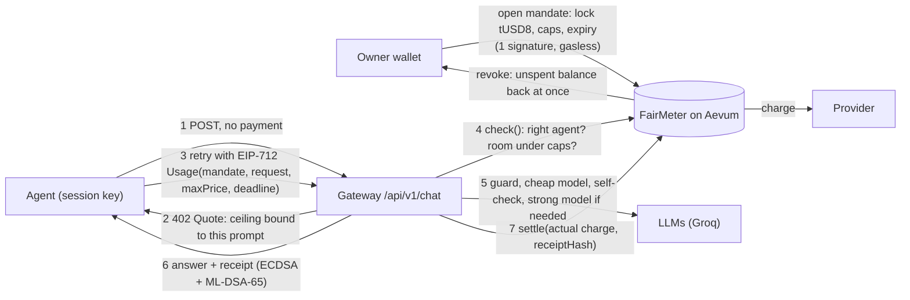
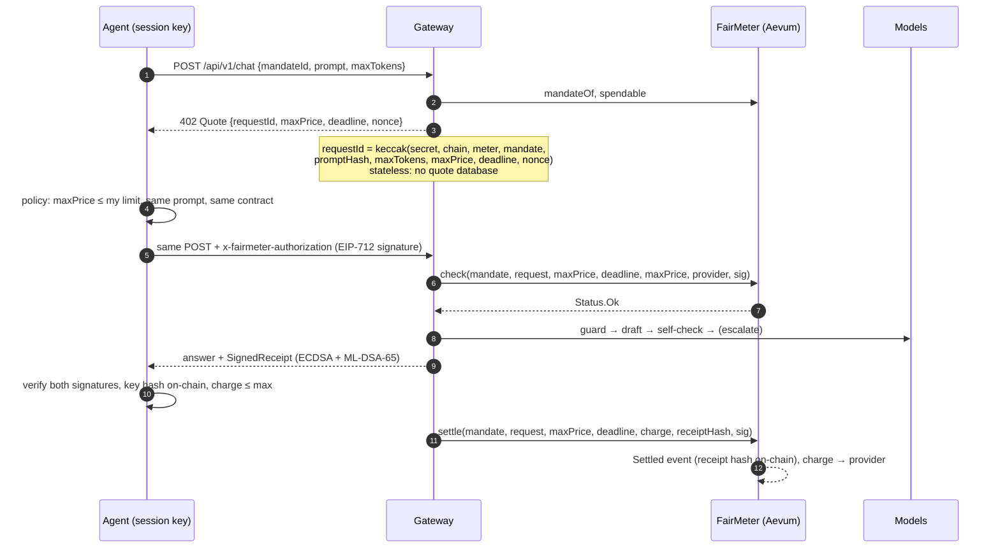

# FairMeter

**Pay-per-request AI for agents, settled in tUSD8 on QDay Aevum.** An owner gives an AI agent a capped, revocable
budget instead of a wallet. For every request the agent signs a price *ceiling*; the provider answers, charges the
*actual* cost (usually a small fraction of the ceiling), and proves it with a receipt signed twice: with an Ethereum
key and with a post-quantum ML-DSA-65 key whose hash is published on-chain.

- **Live app:** https://fairmeter.vercel.app (Aevum testnet, test tokens only)
- **Contract:** [`0x347bB333a61B804C27B17a949fE763b4BA572380`](https://explorer-test.qday.info/address/0x347bB333a61B804C27B17a949fE763b4BA572380) on Aevum (chain 44005)
- **Track:** Aevum Builder Challenge #1 · Native AI Assistants / Decentralized Payments

| | |
|---|---|
| Measured on Aevum (Nov 20) | 7 paid requests: agents authorized 0.6535 tUSD8, the provider charged 0.0878 tUSD8 (13.4%). Live totals: [Activity](https://fairmeter.vercel.app/activity) |
| Cheapest outcome | a prompt-injection attempt, blocked for 0.00002 tUSD8 (only the safety check is billed) |
| Escalation | a modular-arithmetic question the cheap model graded 1/5 went to the 120B model: correct answer, 0.0345 of 0.042 authorized |
| Tests | 27 contract tests (incl. fuzzed money conservation) · 2 fork tests on the real tUSD8 · 8 SDK tests (incl. the EIP-712 digest checked against the deployed contract) |

---

## The problem

An agent that calls paid AI or data APIs cannot know a request's price in advance: it depends on prompt length,
output length and which model ends up answering. Today that leaves two bad options:

1. **Give the agent a wallet key.** A bug, a leaked key or a prompt injection ("send the remaining budget to 0x…")
   can drain everything the key controls.
2. **Prepay the provider.** The money is locked in one vendor's account, usage is opaque, and you trust their bill.

Per-request payment flows such as x402 assume a fixed price per call. Metered AI needs **authorize a maximum,
charge the actual**, the way card networks do authorization and capture, but enforced by a contract and auditable
by anyone.

## How it works



**Owner.** Opens a *mandate*: tUSD8 locked for **one provider**, spendable only with **one agent key**, with a total
cap, a per-request cap and an expiry. One EIP-3009 signature is enough (the provider relays it and pays the gas).
The owner can revoke at any time and gets the unspent balance back in the same transaction, or rotate a leaked
agent key.

**Agent.** Holds only a session key. It asks for a quote (HTTP 402), checks it against its *own* policy (a lower
per-request limit, the exact prompt, the right contract and provider), signs an EIP-712 `Usage` authorization and
retries. Before trusting an answer it verifies the receipt: both signatures, the post-quantum key against the hash
published on-chain, and charge ≤ authorized.

**Provider.** Runs the gateway. Before any model runs it calls `FairMeter.check` on-chain (a dry run that verifies
the agent's signature and the mandate's headroom). Then: a prompt-injection screen
(`llama-prompt-guard-2-86m`), a cheap draft (`gpt-oss-20b`), a self-check by the cheap model, and the strong model
(`gpt-oss-120b`) only if the grade is ≤ 3/5. Each model call is billed at its real token counts. The receipt is
signed with ECDSA and ML-DSA-65; the charge is settled on Aevum right after the response is sent (Next.js `after()`).

### One request, step by step



## Safety model

Each line is a test in [`contracts/test/FairMeter.t.sol`](contracts/test/FairMeter.t.sol) or
[`packages/fairmeter/test/sdk.test.ts`](packages/fairmeter/test/sdk.test.ts).

| Threat | What happens |
|---|---|
| Agent key stolen | The thief can only pay **the mandate's provider**, within the caps, until expiry; only the provider can call `settle`. The owner revokes or rotates the key in one transaction. (`test_stolenAgentKey_cannotPayAnyoneElse`, `test_rotateAgent_oldKeyStops`) |
| Prompt injection ("send the budget to 0x…") | Blocked by the guard before any model runs; costs 0.00002 tUSD8. Even if it got through, the money cannot go anywhere but the provider. |
| Runaway agent loop | Total cap and per-request cap are enforced on-chain (`test_settle_capStopsRunawaySpending`); the agent also refuses quotes above its own lower limit. |
| Provider overcharges | `charge ≤ maxPrice` signed by the agent (`test_settle_rejectsOverMaxPrice`, `test_settle_rejectsRaisedMaxPrice`). |
| Provider charges twice | Each `requestId` settles once (`test_settle_onceOnly`). |
| Cheap quote reused for a long prompt | The request id binds prompt hash, token budget, price, deadline and mandate (`request id binds every quoted term`). |
| Authorization replayed on another mandate | The EIP-712 message includes the mandate id (`test_settle_signatureBoundToMandate`). |
| Relayer changes the terms of a gasless opening | The EIP-3009 nonce is `openNonce(terms)`; any change invalidates the signature (`test_openWithAuthorization_relayerCannotChangeTerms`). |
| Owner revokes while signatures are outstanding | Revocation is immediate; earlier signatures stop working (`test_revoke_refundsAndBlocksEarlierSignatures`). The provider's exposure is at most one request per in-flight call, because it settles right after answering. |
| Forged or edited receipt | Changing any field breaks the hash and both signatures (`receipt: a tampered charge is detected`, `a re-hashed forgery fails both signatures`). |
| Money lost or created | Fuzz test: provider income + mandate balance always equals the deposit, spent never exceeds the cap (`testFuzz_conservation`, 256 runs). |

## QDay platform integration

| Platform piece | How FairMeter uses it |
|---|---|
| **tUSD8 (EIP-3009)** | `openWithAuthorization` pulls funds with `receiveWithAuthorization`; the nonce commits to the mandate terms, so a relayer can sponsor gas without being able to alter anything. |
| **tUSD8 (EIP-2612)** | `openWithPermit`: open a mandate in one transaction without a separate approve. |
| **Agent payments / x402 pattern** | HTTP 402 quote → signed authorization header → paid response, settled on Aevum (not on another chain). |
| **Smart accounts, session keys** | Agents can be EOAs or ERC-1271 smart accounts: a smart wallet's session key works unchanged (`test_smartAccountAgent_sessionKey`). Spending limits, expiry and revocation live in the contract. |
| **Post-quantum roadmap (ML-DSA-65)** | Receipts carry an ML-DSA-65 (FIPS 204) signature. Until QDay's Phase 2 verification precompile is live, the provider publishes its key hash on-chain (`setReceiptKey`, full key in the event log) and anyone verifies off-chain. When the precompile ships, `settle` can verify the PQ signature on-chain with one `staticcall`. |
| **Shanghai EVM** | `evm_version = shanghai`; the build runs the starter kit's opcode check (no `TSTORE`/`MCOPY`; storage-based `ReentrancyGuard`). |
| **1,000-block log limit, no WebSocket** | The Activity and Verify pages read events with `getLogsChunked`; the client polls over HTTPS. |
| **Legacy transactions** | The gateway and scripts send type-0 transactions, like QDay's own faucet. |

## On-chain evidence (Aevum testnet, chain 44005)

| What | Transaction |
|---|---|
| FairMeter deployed (block 3,635,646) | [`0xd32cc672…4ce9`](https://explorer-test.qday.info/tx/0xd32cc672e6849aed5620a2d38e5e6b4715369ac2122efd1dd52467333e654ce9) |
| Provider publishes its ML-DSA-65 receipt key | [`0x255f7535…c111`](https://explorer-test.qday.info/tx/0x255f7535cd0cb02b183c1e48d649682d1d5eebe93d26aa73c5ab9324f5e7c111) |
| Mandate #2 opened (2 tUSD8, 0.2 per request, 30 days) | [`0xd0345aab…7a3c`](https://explorer-test.qday.info/tx/0xd0345aab279c302349fcc517464f81a1f95bd3b2bd38d0855410e215c5917a3c) |
| Easy question: cheap model, charged 0.002011 of 0.041704 | [`0xa0418139…f1b2`](https://explorer-test.qday.info/tx/0xa0418139b1cf5942f5a6f45c187c0a61b071c935591381efd9c6bdf31b9bf1b2) |
| Hard question: escalated to 120B, charged 0.03453 of 0.04201 | [`0x0029ded7…14f1`](https://explorer-test.qday.info/tx/0x0029ded7e677d5f9f57e476500037078dfbf769086378850a540f89a103414f1) |
| Prompt injection blocked, charged 0.00002 | [`0xc9340b9f…24a2`](https://explorer-test.qday.info/tx/0xc9340b9f2361b0f8a4510ca2c57d797a3090456359dc6ff36db6cc57c38724a2) |
| Request through the live Vercel deployment | [`0x13eb4e18…77fd`](https://explorer-test.qday.info/tx/0x13eb4e1893cced0e9d35fe40061331d43643cd1ff31609a922fe9626580a77fd) |
| Gasless mandate opening (#3): owner paid 0 gas | [`0xe08bd684…64da`](https://explorer-test.qday.info/tx/0xe08bd6846f7b9cd7c5343c804cf6bff7f5851ddf29f7ebc2db5baf5bb26164da) |
| Mandate #1 revoked: 1.963 tUSD8 back to the owner | [`0x731b5f96…9ca7`](https://explorer-test.qday.info/tx/0x731b5f96fa970b456bdf75956275dd58af161be01fd861ce51b6301c5d0e9ca7) |

The [Activity page](https://fairmeter.vercel.app/activity) lists every event, read straight from the chain.

## Try it (5 minutes, browser)

1. Add Aevum to MetaMask (RPC `https://rpc-test.qday.info`, chain `44005`, symbol `tQDAY`) and get tUSD8 from the
   QDay Discord faucet (`/faucet <address>`). The [Setup page](https://fairmeter.vercel.app/setup) checks all of it.
2. **Mandates** → lock 1 tUSD8, cap 1, 0.1 per request, 7 days → *Gasless* → sign once. No tQDAY needed.
3. **Agent** → pick a preset (Easy, Hard, Attack) → *Ask and pay*. Watch the six steps, the token-level bill, the
   authorized/charged/returned split, and the settlement transaction.
4. **Verify** → the receipt passes 7 checks. Change one digit of the charge: the hash and both signatures fail.
5. **Mandates** → *Revoke*: the unspent balance is back in your wallet in one transaction.

## Use it from code

```ts
import { createAgent } from "@fairmeter/sdk";
import { privateKeyToAccount } from "viem/accounts";
import { aevumTestnet } from "@aevum-kit/aevum";

const agent = createAgent({
  endpoint: "https://fairmeter.vercel.app/api/v1/chat",
  chain: aevumTestnet,
  meter: "0x347bB333a61B804C27B17a949fE763b4BA572380",
  mandateId: 2n,
  agent: privateKeyToAccount(process.env.AGENT_PRIVATE_KEY as `0x${string}`), // the session key only
  provider: "0x1af380e52295a73FE8694337E8fc5a333ad30ae0",
  policy: { maxPerRequest: 50_000n }, // 0.05 tUSD8: the agent refuses pricier quotes
});

const { answer, signed, check } = await agent.ask("What does HTTP 402 mean?");
// check = { hashOk, ecdsaOk, mldsaOk, pqKeyOnChain, withinMax, ok }
const settled = await agent.waitSettled(signed.receipt.requestId); // { txHash, receiptHash }
```

The raw protocol, for any language:

```bash
# 1. ask for a quote
curl -s -X POST https://fairmeter.vercel.app/api/v1/chat \
  -H 'content-type: application/json' -d '{"mandateId":"2","prompt":"hi","maxTokens":256}'
# -> 402 {"quote":{"requestId":"0x…","maxPrice":"…","deadline":…,"nonce":"0x…",…}}
# 2. sign EIP-712 Usage(mandateId, requestId, maxPrice, deadline), domain {name:"FairMeter", version:"1", chainId:44005, verifyingContract}
# 3. resend the same body with header  x-fairmeter-authorization: base64(JSON {mandateId, requestId, maxPrice, deadline, nonce, signature})
# -> 200 {"answer":"…","receipt":{"receipt":{…},"receiptHash":"0x…","ecdsa":"0x…","mldsa":{…}},"settlement":"submitting"}
```

`GET /api/v1/chat` returns the provider address, contract, prices and the receipt-key hash.

## Repository

```
contracts/src/FairMeter.sol         mandates, Usage authorizations, settle / settleBatch / check, revoke, receipt key
contracts/test/                     27 unit + fuzz tests; fork tests against the real tUSD8 (test/fork)
contracts/script/DeployFairMeter.s.sol
packages/fairmeter/                 @fairmeter/sdk — protocol, EIP-712 usage, dual-signed receipts, pricing, agent client
web/src/app/api/v1/chat/route.ts    the gateway (quote, on-chain check, routing, receipt, settlement)
web/src/app/api/v1/open/route.ts    gasless mandate opening relay
web/src/lib/gateway/                model calls with retries, confidence routing, server config
web/src/app/{mandates,agent,verify,activity,setup}/   the app
examples/src/agent.ts               an autonomous agent (Easy, Hard, Attack tasks)
examples/src/publish-pq-key.ts      publish the provider's ML-DSA-65 key on-chain
scripts/smoke-aevum.sh              one live cycle with cast: open, sign, settle, replay check, revoke
packages/aevum/                     chain config and helpers from the Aevum Starter Kit
```

## Run it yourself

Needs Node 22+, pnpm, Foundry.

```bash
git clone --recursive https://github.com/SRKRZ23/fairmeter && cd fairmeter
make install
make check                      # build + Shanghai check + unit, fork and SDK tests + typecheck
cp web/.env.example web/.env.local   # fill in the server variables below
make dev                        # http://localhost:3000
```

| Variable | Where | What |
|---|---|---|
| `NEXT_PUBLIC_FAIRMETER_AEVUM` | browser | FairMeter address (prefilled with the live one) |
| `NEXT_PUBLIC_DEPLOY_BLOCK_AEVUM` | browser | deploy block, so event scans start there |
| `PROVIDER_PRIVATE_KEY` | server | settlement key of a **test** wallet with a little tQDAY; its address is the provider mandates must name |
| `PQ_SEED` | server | 32-byte seed of the ML-DSA-65 receipt key (`openssl rand -hex 32`); publish once with `pnpm example publish-pq-key` |
| `QUOTE_SECRET` | server | 32-byte secret that binds quotes to request ids |
| `GROQ_API_KEY` | server | model provider key (free tier works) |
| `TRUSTED_IP_HEADER` | server | `x-vercel-forwarded-for` on Vercel, for rate limits |

Your own deployment: `make deploy-aevum ACCOUNT=<foundry keystore>` (or `make deploy-local` on anvil with MockUSD8).
The autonomous agent: `AGENT_PRIVATE_KEY=… MANDATE_ID=… FAIRMETER=… make agent`.

## Pricing (testnet)

Per 1,000 tokens, in tUSD8: `gpt-oss-20b` 0.005 in / 0.02 out · `gpt-oss-120b` 0.015 in / 0.06 out · prompt guard
0.0005 in. The quote is the worst case (guard + draft + check + escalation, each at the token limit); the charge is
what ran. Rates are in every receipt, and the Verify page recomputes each line.

## Business model and path to mainnet

- **Who pays:** teams running agents that call paid AI, data or tool APIs and need a hard budget per agent, per
  vendor, with an audit trail finance can read.
- **Who sells:** API providers (AI inference first) that want agent customers without prepaid accounts or card
  billing, and with proof of every charge.
- **Revenue:** a small fee per settled request on top of the provider's price (a basis-point take rate), or a
  hosted gateway for providers who don't want to run one.
- **Distribution:** the SDK and the gateway route are open source; any provider can put `/api/v1/chat`-style
  metering in front of an existing API in a day.
- **Roadmap:** (1) verify ML-DSA-65 receipts on-chain once QDay's Phase 2 precompile is live; (2) batch settlement
  from a queue (`settleBatch` already skips bad items instead of reverting the batch); (3) shared rate-limit store and
  a provider dispute window; (4) ERC-8004 identity for providers; (5) mainnet with USD8 in Q1 2027.

## Known limits (honest list)

- Testnet only, test tokens only; no audit. The provider key in the demo is a test key.
- The gateway's per-process rails (rate limits, "served once" set) live in memory; on serverless they are per
  instance. The on-chain rails (caps, one settlement per request) are global.
- The provider carries the risk of one unpaid request if an owner revokes between the answer and the settlement.
- ML-DSA-65 signatures are verified off-chain until QDay ships its precompile.
- Model routing quality is a heuristic: the cheap model grades its own draft. It escalated the hard arithmetic
  question in our runs, but it can be over-confident.
- Explorer contract verification is not available on Aevum yet (per the starter kit). Source for the deployed
  contract: this repository at the commit tagged `deployed-aevum`.

## Credits and licenses

MIT. Built on the [Aevum Starter Kit](https://github.com/qday-io/aevum-starter-kit) (MIT, PQA Labs): chain config,
`getLogsChunked`, the setup checker and the app shell. Third-party packages and their licenses: [NOTICE.md](NOTICE.md).
Post-quantum signatures: [`@noble/post-quantum`](https://github.com/paulmillr/noble-post-quantum) (MIT), ML-DSA-65
per FIPS 204. Models served by Groq. All FairMeter code was written during the challenge window (Nov 16 – Dec 11, 2026).
